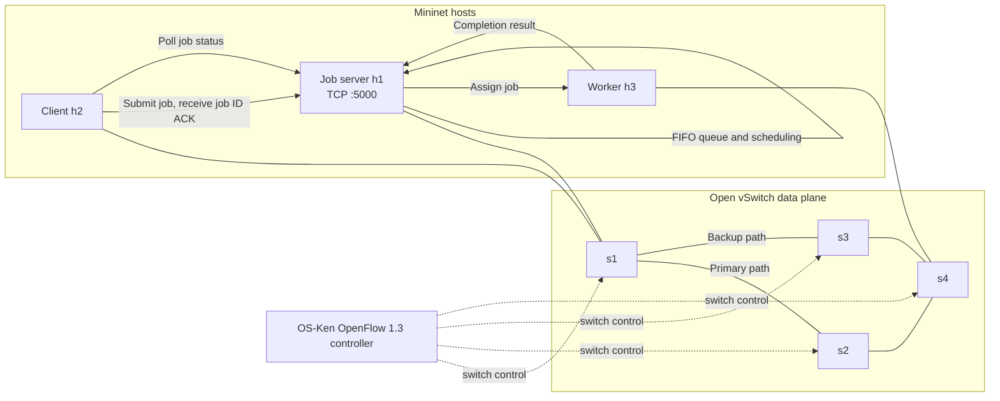

# Team 3 D2 Architecture

## Normal operation

The client submits a job to the TCP server on h1. The server assigns a unique job ID, queues the job, and acknowledges the submission. The scheduler sends queued jobs to registered workers. The worker simulates execution and reports its result; the client-side benchmark polls the server until completion.

## Link failure

Switches s1 and s4 have two paths: s1-s2-s4 and s1-s3-s4. The adaptive controller receives OpenFlow port-state events. When a primary link goes down, it removes route flows and installs routes along the remaining active path when traffic arrives. The static baseline restricts routing to s1-s2-s4 so the same link failure can be compared against adaptive routing.

## D2 verification boundary

The TCP application tests can run on a regular Python installation. The topology and controller require Ubuntu with Mininet, Open vSwitch, and OS-Ken. Save Ubuntu logs and benchmark CSVs as evidence; do not treat this diagram or source code alone as proof that link failover ran successfully.
